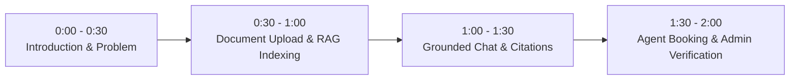

# BizAgent AI — 2-Minute Video Demo Script

This script is designed for Ashok to record a polished, concise 2-minute demo video showcasing BizAgent AI for LinkedIn, GitHub, and hiring managers.

- **Total Duration**: 2 minutes (120 seconds)
- **Live Frontend**: https://frontend-olive-gamma-5ulqmpuck7.vercel.app
- **Live Backend API**: https://bizagent-ai-backend.onrender.com

---

## ⏱️ Timeline & Action Guide

---

### Part 1: Introduction & Problem (0:00 – 0:30)

| Timestamp | What to Say (Spoken Voiceover) | What to Click / Show on Screen |
| :--- | :--- | :--- |
| **0:00 – 0:15** | *"Hi everyone, I'm Ashok. Today I'm excited to showcase **BizAgent AI** — an intelligent, production-ready AI agent platform built for small businesses like clinics, law firms, and service agencies."* | Open Chrome browser to **[https://frontend-olive-gamma-5ulqmpuck7.vercel.app](https://frontend-olive-gamma-5ulqmpuck7.vercel.app)**. Show the clean header with the 3 navigation tabs: **Chat**, **Upload**, and **Admin**. |
| **0:15 – 0:30** | *"Small businesses receive repetitive questions every single day. BizAgent AI solves this by grounding an AI assistant strictly in uploaded business documents using RAG, while autonomously handling real-world business actions like appointment booking, lead capture, and support tickets in MongoDB Atlas."* | Move cursor across the tabs to highlight the intuitive single-page interface. |

---

### Part 2: Upload Business Knowledge (0:30 – 1:00)

| Timestamp | What to Say (Spoken Voiceover) | What to Click / Show on Screen |
| :--- | :--- | :--- |
| **0:30 – 0:45** | *"Let's see how a business gets started. I'll navigate to the **Upload** tab. Here, a business owner can upload policy guidelines, clinic operating hours, or FAQs in PDF or text format."* | Click on the **Upload** tab. Show the clean file uploader and fixed Business ID badge (`mysuru_clinic_01`). |
| **0:45 – 1:00** | *"When I select our clinic guide and click upload, the FastAPI backend chunks the text using LangChain, generates embeddings with Gemini, and stores vectors into ChromaDB for millisecond retrieval."* | Click **Choose File**, select `mysuru_clinic_info.txt`, and click **Upload Document**. Show the green success card with chunk count, document ID, and character count. |

---

### Part 3: Grounded RAG Chat with Citations (1:00 – 1:30)

| Timestamp | What to Say (Spoken Voiceover) | What to Click / Show on Screen |
| :--- | :--- | :--- |
| **1:00 – 1:15** | *"Now let's switch to the **Chat** tab as a customer. I'll ask: 'What are the outpatient consultation timings for Mysuru Wellness Clinic?'"* | Click on the **Chat** tab. Type or paste: `What are the outpatient consultation timings for Mysuru Wellness Clinic?` and hit **Send Message**. |
| **1:15 – 1:30** | *"Notice how fast the answer arrives, quoting the exact timings from Monday to Saturday, 8 AM to 8 PM, and Sunday hours. Crucially, the system attaches a strict source citation badge `[mysuru_clinic_info.txt]` to eliminate hallucination."* | Point cursor to the green **Answer** badge, the exact timing text, and the **Source [mysuru_clinic_info.txt]** chip. |

---

### Part 4: Autonomous Tool Calling & Admin Verification (1:30 – 2:00)

| Timestamp | What to Say (Spoken Voiceover) | What to Click / Show on Screen |
| :--- | :--- | :--- |
| **1:30 – 1:45** | *"BizAgent goes beyond simple question answering — it takes action. Watch this: I'll ask it to 'Book an appointment for Ananya Rao for skin consultation on November 29 at 10:30 AM, phone 9123456789'."* | Type: `Book an appointment for Ananya Rao for skin consultation on 2026-11-29 at 10:30 AM, phone 9123456789` and click **Send Message**. Show the action badge turning to `book_appointment` with a confirmation ID. |
| **1:45 – 2:00** | *"The agent calls our booking tool and writes directly to MongoDB Atlas. Let's switch to the **Admin** tab — and right there in real time, Ananya's appointment is logged with date, time, service, and booked status.*  *BizAgent AI is containerized with Docker, deployed live on Render and Vercel, and backed by a comprehensive 20-test RAG evaluation suite. Check out the live links and GitHub repository below. Thank you!"* | Click the **Admin** tab. Click **Refresh Data** if needed. Show Ananya Rao's appointment row prominently in the Appointments table. Scroll to show Tickets and Leads tables as well. |

---

## 💡 Quick Tips for Ashok Before Recording:
1. **Screen Resolution**: Set display scaling to 100% or 125% so text is crisp and easily readable.
2. **Browser Window**: Maximize Chrome and close unnecessary tabs or bookmarks.
3. **Pacing**: Speak at a steady, confident pace; leave 1 second after clicking each button so the viewer can follow the UI transition.
