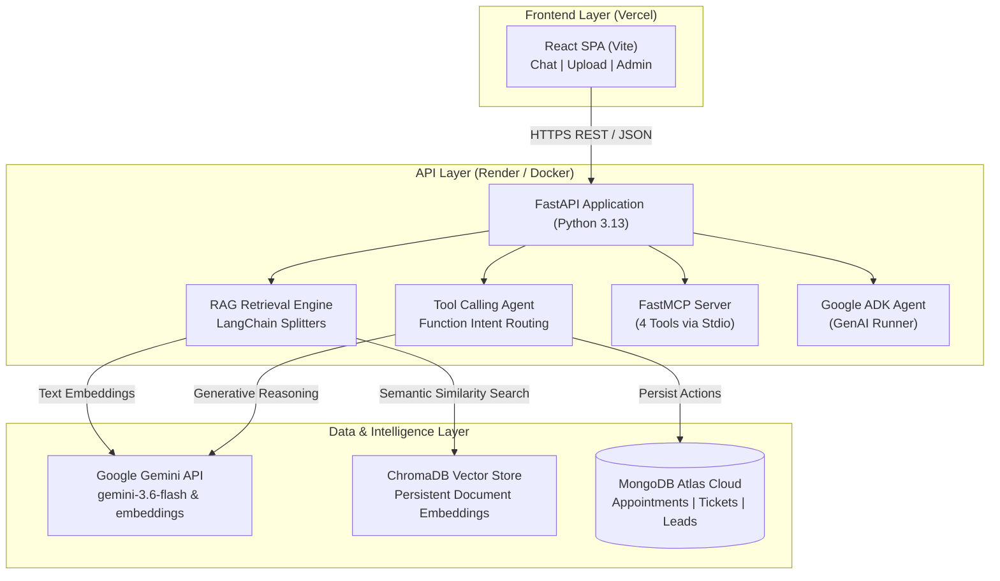

# BizAgent AI

> **Intelligent AI Agent Platform for Small Businesses** — Grounded customer support via Retrieval-Augmented Generation (RAG) and autonomous business workflows (appointment booking, support ticketing, and lead capture) backed by MongoDB Atlas.

---

## 🚀 Live Cloud Deployment

| Service | Component | URL |
| :--- | :--- | :--- |
| **Frontend** | React SPA (Vite) on Vercel | [https://frontend-olive-gamma-5ulqmpuck7.vercel.app](https://frontend-olive-gamma-5ulqmpuck7.vercel.app) |
| **Backend API** | FastAPI on Render (Free Tier) | [https://bizagent-ai-backend.onrender.com](https://bizagent-ai-backend.onrender.com) |
| **Health Check** | Live Database & Service Status | [https://bizagent-ai-backend.onrender.com/health](https://bizagent-ai-backend.onrender.com/health) |
| **Interactive API Docs** | FastAPI Swagger UI | [https://bizagent-ai-backend.onrender.com/docs](https://bizagent-ai-backend.onrender.com/docs) |

> [!NOTE]
> All cloud credentials (MongoDB Atlas URI, Google Gemini API Key) are managed strictly via environment variables in Render and Vercel. No keys or connection strings are committed to the repository.

---

## 🏛️ System Architecture



---

## ✨ Key Features

- **Document Ingestion & RAG**: Upload `.pdf` and `.txt` business documents; chunk with `RecursiveCharacterTextSplitter`, embed with `models/gemini-embedding-001`, and store in persistent ChromaDB collections.
- **Strict Guardrails & Citations**: Answers questions strictly from context with verified source badges (e.g. `[mysuru_clinic_info.txt]`). Unknown queries reliably trigger the fallback guardrail: *"I don't know based on the documents provided."*
- **Autonomous Tool Calling**: Automatically routes customer intent to execute backend actions:
  - `book_appointment`: Books appointments and saves to MongoDB.
  - `create_ticket`: Creates customer support tickets.
  - `save_lead`: Captures prospective customer inquiries.
- **FastMCP Protocol Integration**: Exposes 4 standard tools (`search_documents`, `book_appointment`, `create_ticket`, `save_lead`) via Model Context Protocol over stdio.
- **Google Agent Development Kit (ADK)**: Native ADK agent integration with `InMemorySessionService` and `Runner` for conversational agent execution.
- **Administrative Dashboard**: Real-time view of customer appointments, tickets, captured leads, and document chunk statistics.
- **Production Containerization**: Fully Dockerized backend (`python:3.13-slim`) and multi-stage Nginx frontend (`node:22-alpine` -> `nginx:alpine`) orchestrated via `docker-compose.yml`.

---

## 📊 RAG Evaluation Benchmark

A live 20-question automated evaluation suite was executed against the production Render API endpoint (`POST /api/chat`), covering in-document factual retrieval, out-of-document guardrail resistance, and edge cases:

- **Overall Score**: **15/20 Correct (75.0%)**
- **In-Document Query Accuracy**: **10/12 (83.3%)** — 100% precision on business hours, doctors, location, and services with exact source citations.
- **Out-of-Document Guardrail Accuracy**: **4/5 (80.0%)** — Reliably prevented hallucinations on unrelated questions (medical advice, flights, unrelated retail).
- **Edge Cases Handled**: **1/3 (33.3%)** — Clean HTTP 400 validation rejection on empty inputs; verbose and typo queries benchmarked.
- *Full evaluation report and question-by-question breakdown available in [`backend/eval_results.md`](backend/eval_results.md).*

---

## 🛠️ Tech Stack

- **Frontend**: React 18, Vite, Plain Modern CSS (responsive cards, tabs, chips)
- **Backend**: FastAPI, Uvicorn, Python 3.13, Pydantic v2
- **AI & RAG**: Google Gemini (`gemini-3.6-flash`, `gemini-embedding-001`), LangChain
- **Databases**: ChromaDB (Vector Store), MongoDB Atlas (Cloud NoSQL)
- **Protocols & Agent SDKs**: Model Context Protocol (FastMCP 1.30.0), Google ADK (1.20.0)
- **DevOps & Cloud**: Docker, Docker Compose, Render (Web Service), Vercel (SPA Hosting)

---

## ⚙️ Environment Variables

The project requires the following environment variables (set in `backend/.env` for local execution or configured in cloud dashboard settings):

| Variable Name | Description | Example / Format |
| :--- | :--- | :--- |
| `GEMINI_API_KEY` | Google Gemini API key from Google AI Studio | `AIzaSy...` |
| `MONGO_URI` | MongoDB connection URI (Atlas or local) | `mongodb+srv://...` |
| `MONGO_DB` | Database name | `bizagent_db` |
| `VITE_API_URL` | *(Frontend)* Backend API base URL | `https://bizagent-ai-backend.onrender.com` |
| `CORS_ORIGINS` | *(Optional)* Comma-separated allowed frontend origins | `https://frontend-*.vercel.app` |

---

## 💻 Local Development & Execution

### Option A: Run with Docker Compose (Recommended)
Clone the repository and start both backend and frontend with a single command:
```bash
docker compose up --build -d
```
Access points:
- **Frontend App**: [http://localhost:5173](http://localhost:5173)
- **Backend API**: [http://localhost:8000](http://localhost:8000)
- **Health Check**: [http://localhost:8000/health](http://localhost:8000/health)
- **API Documentation**: [http://localhost:8000/docs](http://localhost:8000/docs)

To stop containers:
```bash
docker compose down
```

### Option B: Run Locally Without Docker

#### 1. Setup Virtual Environment & Dependencies
```bash
python -m venv venv

# Windows (PowerShell):
.\venv\Scripts\Activate.ps1
# Linux/macOS:
source venv/bin/activate

pip install -r backend/requirements.txt
```

#### 2. Configure Environment
```bash
cp backend/.env.example backend/.env
# Add your GEMINI_API_KEY and MONGO_URI in backend/.env
```

#### 3. Run Backend Server
```bash
cd backend
uvicorn main:app --reload --port 8000
```

#### 4. Run Frontend App
```bash
cd frontend
npm install
npm run dev
```

---

## 📹 Video Demo Script

A detailed 2-minute spoken walk-through script with screen recording timestamps and click guide is available in [`DEMO_SCRIPT.md`](DEMO_SCRIPT.md).

---

## 📈 Project Milestones

- **Day 1**: FastAPI skeleton setup, MongoDB connection helper, Pydantic models, pinned dependencies.
- **Day 2**: Document upload, text extraction (.pdf & .txt), recursive chunking, Gemini embeddings (`models/gemini-embedding-001`), persistent ChromaDB storage.
- **Day 3**: RAG chat endpoint (`/api/chat`) with strict guardrails and source citations.
- **Day 4**: Autonomous tool calling (`/api/agent/chat`) with intent routing persisting to MongoDB Atlas.
- **Day 4b**: FastMCP server with 4 tools over stdio + Google ADK agent (`/api/adk/chat`).
- **Day 5**: Vite React frontend with Customer Chat, Upload Documents, and Admin Dashboard.
- **Day 6**: Containerization with Dockerfile and Docker Compose orchestration.
- **Day 7**: Production cloud deployment: Render backend (Free Tier) + Vercel frontend.
- **Day 8**: RAG evaluation benchmark (20 test cases), interview-ready documentation, and demo walk-through script.
